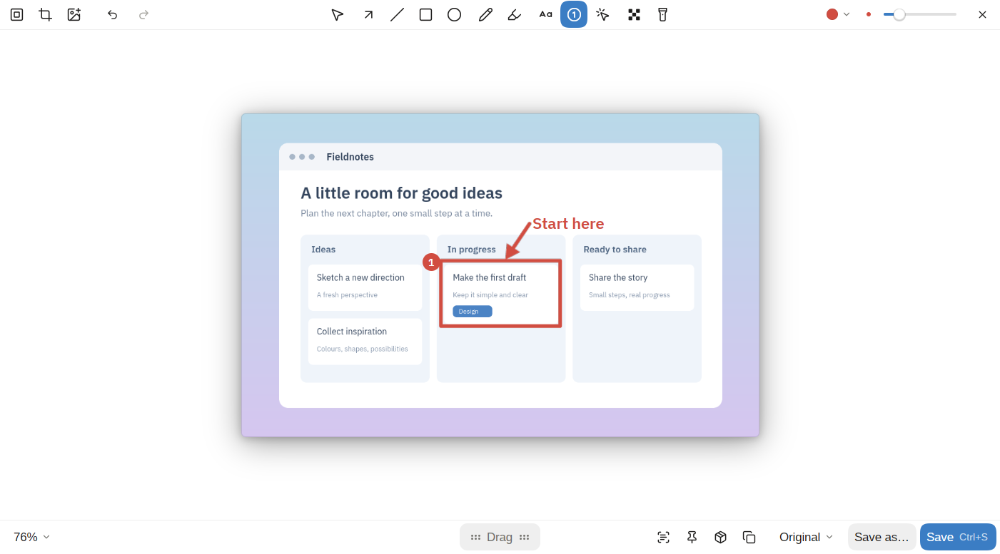

# kadr

Screenshots and screen recording for the desktop: capture an area, a window or the screen, annotate it, record with your camera and clicks, and turn a recording into a polished video. Written in Rust on [GPUI CE](https://github.com/gpui-ce/gpui-ce). Made first for Linux on [Omarchy](https://omarchy.org) (Arch, Hyprland, Wayland), coming to macOS and Windows. English and Russian; dark and light themes follow the system.



**Status:** works on Linux (Wayland, Hyprland). macOS and Windows build and pass their end-to-end test in CI (the editor, typing, the system's menus, the area overlay), but nobody has used them on a real machine yet, and the camera and the studio's click log aren't ported there. The latest pre-release is on [Releases](https://github.com/evlaso/kadr/releases); testers on macOS and Windows are very welcome.

## What it does

- **One bar for everything** (`kadr capture`): area, fullscreen, window, scrolling, self-timer, text recognition and recording behind a single hotkey. After a capture a thumbnail shows in the corner: copy, edit, pin on top, recognize text, drag the file into a chat.
- **A screenshot editor:** arrows, boxes, text in seven styles, step numbers, a highlighter that follows a line of text, hiding that can't be undone, crop, a background with padding, rounding and a shadow, presets, pictures dropped in.
- **Screen recording** with the microphone, system audio, a camera bubble and a log of clicks and keys; **a studio** that turns the recording into a video: zooms on clicks, cuts, a smooth large cursor, MP4 or GIF.
- **The rest:** text recognition, a history of captures, `.kadr` project files, settings with search and a `settings.toml` with a comment on every line, a tray icon, updates from kadr itself.

Every screen, key and setting is in the **[manual](https://evlaso.github.io/kadr/)**, also in [docs/manual](docs/manual).

## Install

[Releases](https://github.com/evlaso/kadr/releases) has builds for the three systems: a `.tar.xz` for Linux (with an `INSTALL.md`), `Kadr.app` in a `.dmg` for macOS (Apple silicon and Intel) and an installer or a portable `.exe` for Windows. They aren't signed yet: on macOS run `xattr -dr com.apple.quarantine /Applications/Kadr.app` once after copying the app. Homebrew, winget and the AUR come later. kadr can also be built from source, which needs Rust 1.95 or newer.

### Linux (Hyprland)

kadr needs `gpu-screen-recorder`, `ffmpeg`, `tesseract` (with English data), `grim` and `wl-clipboard`. On Omarchy they're either there already or come from `pacman`. `mpv` is optional: the trim window's Play and the studio's Preview play through it.

```sh
cargo build --profile dist -p kadr -p kadr-tray
install -m755 target/dist/kadr target/dist/kadr-tray ~/.local/bin/
```

Add the Hyprland hook: it floats kadr's windows, loads the hotkeys set in kadr's settings, and logs clicks and keys for the studio.

```sh
cp data/hypr/kadr.lua ~/.config/hypr/kadr.lua
```

Then add `require("hypr.kadr")` to `~/.config/hypr/hyprland.lua`, and start the tray icon from `autostart.lua`:

```lua
o.launch_on_start("kadr-tray")
```

### macOS and Windows

Build kadr, its tray and its area overlay, and keep the three side by side:

```sh
cargo build --profile dist -p kadr -p kadr-tray -p kadr-overlay
```

The tray holds the global hotkeys there, so start `kadr-tray` at login. Unsigned builds of every commit are attached to the [Actions](https://github.com/evlaso/kadr/actions) runs started by hand; on macOS such a build needs `xattr -d com.apple.quarantine kadr kadr-tray kadr-overlay` before it opens.

## Hotkeys

Set them in kadr's settings (Shortcuts). The defaults on macOS and Windows; on Linux kadr starts from your Hyprland bindings:

| Keys | Does |
|---|---|
| Ctrl+Shift+1 | Screenshot of an area |
| Ctrl+Shift+2 | Recording |
| Ctrl+Shift+3 | Recognize text |
| Ctrl+Shift+4 | History |
| Ctrl+Shift+5 | Settings |
| Ctrl+Shift+6 | Scrolling screenshot |

While picking an area: Space for windows only, A for an aspect ratio, digits for a size, arrows to nudge (Alt+arrows to resize), P for the last area, Enter to take it, Esc to cancel.

## Commands

```
kadr capture                                       every mode on one bar
kadr shot [smart|region|windows|fullscreen|timer|previous]
                                                   screenshot (previous: the last area again)
kadr shot scroll                                   scrolling screenshot
kadr record                                        recording bar (again to stop)
kadr record region|fullscreen [--studio] …         start recording at once
kadr record previous                               recording bar for the last area
kadr edit <image|project.kadr>                     screenshot editor
kadr studio <video|project.kadr>                   studio
kadr open <project.kadr>                           a project, in the editor or the studio
kadr text [image]                                  recognize text
kadr history                                       history
kadr settings                                      settings
kadr tray                                          tray icon
kadr install-desktop                               .kadr file type, icon and menu entry
```

`kadr --help` lists all of them.

## Platforms

- **Linux** (Wayland, Hyprland): everything works.
- **macOS and Windows:** the editor, the studio, screenshots (window and scrolling shots too), recording through the system's capture, the clipboard, notifications, the tray, global hotkeys and the area overlay are written and pass the end-to-end test on CI's runners; the camera, choosing a microphone and the studio's click and key log aren't ported yet. Everything system-specific lives in `crates/kadr-platform`.

## Development

[CONTRIBUTING.md](CONTRIBUTING.md) has how to build and test. The manual's source is [docs/manual](docs/manual). Where the project is heading is [docs/SPEC.md](docs/SPEC.md), in what order [docs/ROADMAP.md](docs/ROADMAP.md); the measurements are in [docs/perf.md](docs/perf.md), known debts and pitfalls in [docs/traps.md](docs/traps.md), and [CLAUDE.md](CLAUDE.md) is the guide for coding agents.

## License

[MIT](LICENSE). Bundled third-party pieces keep their own licenses: the Lucide icons (ISC, `data/icons/ui/LICENSE-lucide.txt`), the fonts (SIL OFL 1.1, `data/fonts`), the fallback cursors (Adwaita by the GNOME Project, CC BY-SA 3.0, `data/cursors/LICENSE`), and the patched GPUI CE Linux platform crate (Apache-2.0, `vendor/gpui_linux`).
