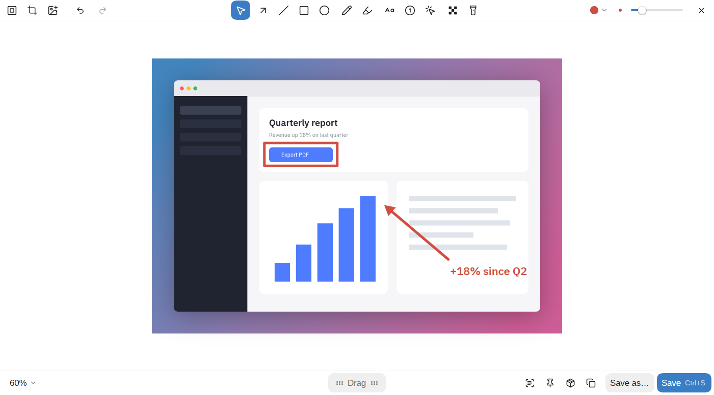

# kadr

Скриншоты и запись экрана: снять область, окно или весь экран, разметить, записать видео с камерой и кликами и превратить запись в аккуратный ролик. Написан на Rust и [GPUI CE](https://github.com/gpui-ce/gpui-ce). Сначала для Linux под [Omarchy](https://omarchy.org) (Arch, Hyprland, Wayland), дальше — macOS и Windows. Интерфейс на английском и русском, тёмная и светлая темы следуют системе.



**Статус:** работает на Linux (Wayland, Hyprland). macOS и Windows собираются и проходят сквозной тест в CI (редактор, ввод текста, системные меню, оверлей выбора области), но живьём на них ещё никто не работал, а запись и выбор окон там пока не перенесены. Первый пре-релиз — [0.3.0-alpha.1](https://github.com/evlaso/kadr/releases); очень ждём тестеров на macOS и Windows.

[Read in English](../README.md)

## Что умеет

- **Одна панель для всего** (`kadr capture`): область, весь экран, окно, прокрутка, таймер, распознавание текста и запись на одной горячей клавише.
- **Скриншоты** области, окна или экрана, а также длинные с прокруткой (`kadr shot scroll`: выбираешь область и прокручиваешь, kadr склеивает). После снимка в углу появляется карточка: копировать, редактировать, закрепить поверх окон, распознать текст, перетащить файл в чат. Клик без выделения копирует цвет под курсором. Окно снимается со скруглёнными углами и мягкой тенью на прозрачном фоне. Выделение можно оставить и поправить: ручки, стрелки, пропорции (A) или точный размер цифрами; P или `kadr shot previous` снимает прошлую область.
- **Редактор скриншотов:**
  - стрелки (их можно изгибать) и линии, прямоугольники и эллипсы (контуром или с заливкой), карандаш, маркер;
  - текст (обычный, на плашке или с обводкой), нумерация шагов, пикселизация, прожектор, обрезка;
  - фон в боковой панели (градиент, сплошной цвет, обои, размытый снимок или прозрачный), отступы, скругление, тень и выбор формата;
  - «Сохранить», «Сохранить как…», проект `.kadr`, копирование, закрепление поверх окон и распознавание текста с нижней панели;
  - пресеты: «+» сохраняет вид, в выпадающем списке его можно выбрать, переименовать или удалить (в студии так же);
  - картинки поверх снимка: перетащи файл в редактор или вставь через Ctrl+V;
  - один ползунок размера для всех инструментов, масштаб холста.
- **Запись экрана:**
  - панель у выделенной области: микрофон (с индикатором громкости), звук системы, камера, лог сочетаний клавиш, обратный отсчёт; панель появляется сразу, как отпустишь мышь, а область на ней можно править (ручки, перетаскивание, стрелки, размер из меню или цифрами), а дубль можно начать заново прямо с панели записи;
  - пузырь камеры, который настраивается до записи: тащишь (прилипает к углам и краям), меняешь размер и скругление;
  - режим студии: системный курсор не попадает в запись, kadr рисует свой, крупный и плавный; камера пишется отдельно.
- **Студия** (видеоредактор): настройки по разделам в колонке слева, таймлайн с дорожкой зумов над кадрами, настройки экспорта под кнопкой «Экспорт»:
  - воспроизведение прямо в редакторе;
  - зумы к кликам, обрезка начала и конца, вырезание кусков;
  - фон, отступы, скругление, тень, форматы 16:9, 1:1, 4:5, 9:16;
  - кольца на месте кликов, плашки с сочетаниями клавиш, курсор нужного размера и плавности, размытие в движении;
  - камера кругом, скруглённым или квадратом в любой из восьми точек;
  - экспорт в MP4 или GIF с выбором сжатия и предварительной оценкой размера файла; прогресс идёт на размытой карточке, которая потом становится результатом.
- **Остальное:**
  - обрезка записи и GIF прямо из карточки;
  - распознавание текста (английский и русский);
  - история снимков и записей: поиск, фильтры, перетаскивание файлов;
  - настройки с поиском, в том числе горячие клавиши, тема, язык, место на диске и автоочистка старых снимков;
  - иконка в трее;
  - файлы проектов: «Проект» в редакторе или студии сохраняет файл `.kadr` со всей правкой (исходная картинка или запись, все фигуры, зумы и вырезки), чтобы открыть его потом или на другом компьютере. kadr регистрирует этот тип файлов при первом запуске (вручную — `kadr install-desktop`), так что `.kadr` открываются в kadr прямо из файлового менеджера.

## Установка

В [Releases](https://github.com/evlaso/kadr/releases) лежат сборки для трёх систем: `.tar.xz` для Linux (с `INSTALL.md` внутри), `Kadr.app` в `.dmg` для macOS (Apple silicon и Intel) и портативный `.zip` для Windows. Они пока не подписаны: на macOS после копирования приложения один раз выполните `xattr -dr com.apple.quarantine /Applications/Kadr.app`. Homebrew, winget и AUR появятся позже. Ещё kadr можно собрать из исходников, нужен Rust 1.95 или новее.

### Linux (Hyprland)

Нужны `gpu-screen-recorder`, `ffmpeg`, `tesseract` (с английскими данными), `grim` и `wl-clipboard`. В Omarchy они либо уже стоят, либо ставятся из `pacman`.

```sh
cargo build --profile dist -p kadr -p kadr-tray
install -m755 target/dist/kadr target/dist/kadr-tray ~/.local/bin/
```

Подключите хук для Hyprland: он делает окна kadr плавающими, подхватывает хоткеи из настроек kadr и пишет клики и клавиши для студии.

```sh
cp data/hypr/kadr.lua ~/.config/hypr/kadr.lua
```

Затем добавьте `require("hypr.kadr")` в `~/.config/hypr/hyprland.lua`, а иконку в трее запускайте из `autostart.lua`:

```lua
o.launch_on_start("kadr-tray")
```

### macOS и Windows

Соберите kadr, трей и оверлей выбора области и держите все три рядом:

```sh
cargo build --profile dist -p kadr -p kadr-tray -p kadr-overlay
```

Глобальные хоткеи там держит трей, поэтому `kadr-tray` нужно запускать при входе в систему. Неподписанные сборки прикладываются к запущенным вручную прогонам в [Actions](https://github.com/evlaso/kadr/actions); на macOS перед первым запуском такой сборки нужно `xattr -d com.apple.quarantine kadr kadr-tray kadr-overlay`.

## Хоткеи

Настраиваются в настройках kadr (раздел «Клавиши»). По умолчанию на macOS и Windows; на Linux kadr берёт ваши привязки Hyprland:

| Клавиши | Что делает |
|---|---|
| Ctrl+Shift+1 | Скриншот области |
| Ctrl+Shift+2 | Запись |
| Ctrl+Shift+3 | Распознать текст |
| Ctrl+Shift+4 | История |
| Ctrl+Shift+5 | Настройки |
| Ctrl+Shift+6 | Скриншот с прокруткой |

При выборе области: пробел — только окна, A — пропорции, цифры — точный размер, стрелки — сдвиг (Alt+стрелки — размер), P — прошлая область, Enter — снять, Esc — отмена.

## Команды

```
kadr capture                                       все режимы на одной панели
kadr shot [smart|region|windows|fullscreen|timer|previous]
                                                   скриншот (previous — прошлая область)
kadr shot scroll                                   скриншот с прокруткой
kadr record                                        панель записи (повторный вызов — стоп)
kadr record region|fullscreen [--studio] …         начать запись сразу
kadr record previous                               панель записи для прошлой области
kadr edit <картинка|проект.kadr>                   редактор скриншотов
kadr studio <видео|проект.kadr>                    студия
kadr open <проект.kadr>                            проект, в редакторе или студии
kadr text [картинка]                               распознать текст
kadr history                                       история
kadr settings                                      настройки
kadr tray                                          иконка в трее
kadr install-desktop                               тип файлов .kadr, иконка и пункт меню
```

Все команды показывает `kadr --help`.

## Платформы

- **Linux** (Wayland, Hyprland): работает всё.
- **macOS и Windows:** редактор, студия, скриншоты, буфер обмена, уведомления, трей, глобальные хоткеи и оверлей выбора области написаны и проходят сквозной тест на раннерах CI; запись, выбор окон и лог кликов для студии пока не перенесены. Всё, что зависит от системы, лежит в `crates/kadr-platform`.

## Разработка

Как собрать и прогнать тесты — в [CONTRIBUTING.md](../CONTRIBUTING.md). Куда идёт проект — в [SPEC.ru.md](SPEC.ru.md); замеры — в [perf.md](perf.md), известные долги и ловушки — в [traps.md](traps.md), а [CLAUDE.md](../CLAUDE.md) — руководство для ИИ-агентов.

## Лицензия

[MIT](../LICENSE). Сторонние части в комплекте — под своими лицензиями: иконки Lucide (ISC, `data/icons/ui/LICENSE-lucide.txt`), шрифты (SIL OFL 1.1, `data/fonts`), запасные курсоры (Adwaita от GNOME Project, CC BY-SA 3.0, `data/cursors/LICENSE`) и пропатченный Linux-крейт GPUI CE (Apache-2.0, `vendor/gpui_linux`).
