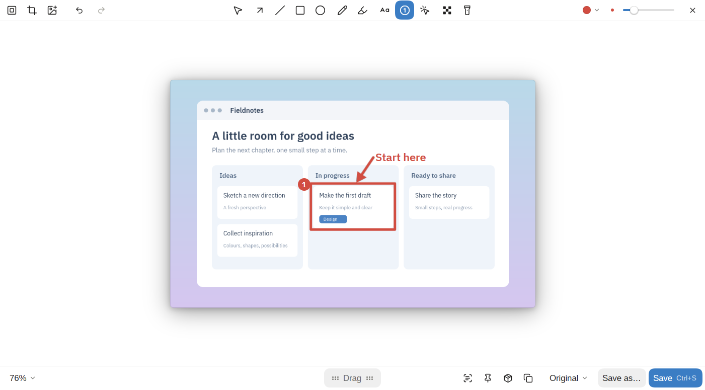
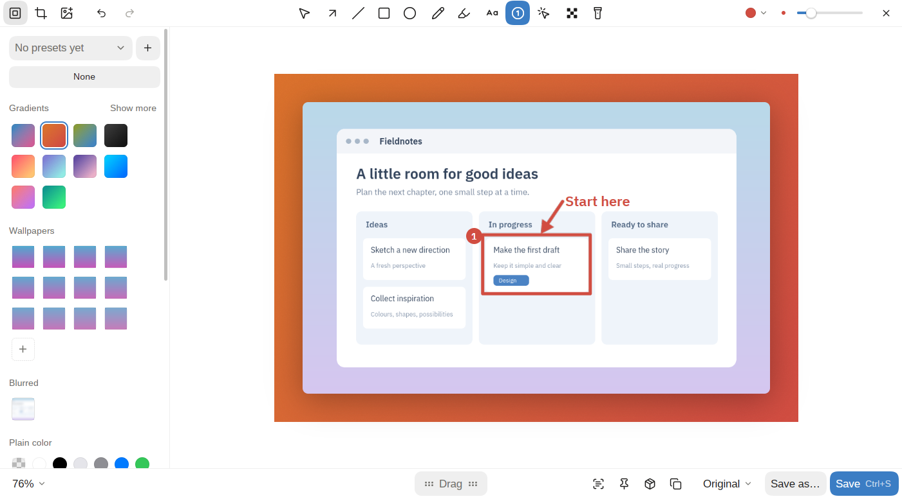

# Editor

The editor is where a screenshot gets its arrows, boxes, text and step numbers, where private details are hidden, and where the picture is cropped and put on a background. What you draw stays editable: open the saved file in the editor again and every shape comes back.



It opens PNG, JPEG and WebP pictures, and `.kadr` project files.

## How to open

- **From the card** after a screenshot: **Edit**.
- **Right after every screenshot:** turn on Settings → Screenshots → **Open the editor**.
- **From History:** select a screenshot and press E, or click **Edit**.
- **From the command line:** `kadr edit <image|project.kadr>`. `kadr open` with a `.kadr` file opens its project too.
- **From the file manager:** `.kadr` files open in kadr (see [Project files](projects.md)).

On Linux the editor opens as an ordinary window by default; it can cover the whole screen instead (see Settings below). On macOS and Windows it's always a window.

## Tools

The tools sit in the top bar, in groups. Each has a letter; the tooltip says the tool's name. When the window is narrow, the last tools fold under **More tools**.

| Key | Tool | What it does |
|---|---|---|
| V | Select and move | Click a shape to select it, drag it to move it, pull its handles to resize it. Drag on empty space to select several. |
| A | Arrow | Draws an arrow. Drag its middle handle to bend it. Styles: **Arrow** (a filled head), **Open head**, **Both ends**, **Tapered** (thin at the tail, wide at the head). |
| L | Line | A straight line; it bends like an arrow. |
| R | Rectangle | A box, **Outline** or **Fill**. |
| O | Ellipse | An ellipse, **Outline** or **Fill**. |
| P | Pencil | Freehand drawing. |
| H | Highlighter | A see-through marker. Over a line of text it fits the line's height and stays level; leave the line, or hold Shift, to draw freely. |
| T | Text | Click to type. Click an existing text to edit it; drag it to move it. Seven styles: **Plain text**, **On a plate**, **Outlined**, **With a shadow**, **Highlighted**, **In a pill**, **Label**. |
| N | Step numbers | Each click puts the next number: 1, 2, 3… |
| M | Cursor | Stamps a pointer: **Arrow**, **Pointing hand**, **Text**, **Open hand**, **Closed hand**, **Crosshair**, **Busy**, **Not allowed**. They are your system's own pointer pictures. |
| B | Hide | Covers an area: **Pixelate**, **Blur**, or a black box. |
| S | Spotlight | Dims everything around the area you draw. |
| C | Crop | Crop, turn and resize the picture (see Crop below). |

Hold Shift while drawing for squares, circles, and lines and arrows at 45° steps.

**Hide** is built to stay hidden: the blur and the pixelation are mixed with noise so the text can't be brought back, and with the black box what's under it is gone from the saved file altogether. With the hide tool picked, **Hide sensitive** in the top bar finds e-mails, keys, card and phone numbers in the picture and covers each one the way picked; one undo takes them all off. It reads the picture with tesseract, which has to be installed.

## Colour, size and a shape's options

- **Colour and size** stay in the top bar's corner. They apply to the next shape, and to the selected one.
- **The colour menu** has kadr's eight colours (keys 1–8), the pipette (I: click the picture to take a colour from it), **Recent** colours, and **Yours**: + keeps the current colour there, right-click one to remove it.
- **A shape's own options** float in a bar under the selected shape: an arrow's style, a box's fill, a text's style, how an area is hidden, a pointer's look. An arrow, a box, an ellipse or a hidden area stays selected after you draw it, so its bar is right there. The next shape takes what you picked last.
- **Undo and redo** are in the top bar too.

## Background and presets

The background button in the top bar opens a sidebar:



- **Presets** at the top: + saves the current look as a preset, the dropdown picks one, and each can be renamed or deleted from there.
- **None**, **Gradients** (**Show more** for the rest), **Wallpapers** (the Omarchy themes' backgrounds, where there are any, plus **Your own image…**), **Blurred** (the screenshot itself, blurred), **Plain color** (including **Transparent**).
- **Padding**, **Corners** and **Shadow** sliders.
- **Aspect ratio:** **Auto**, 16:9, 4:3, 1:1 or 9:16. The final size shows under it.
- **Position:** where the picture sits on a 3×3 grid. Off the middle it sits flush with that edge or corner. **Even margins** trims the screenshot's plain margins to match, so what's in it sits in the middle.

**Pictures** can be added to a screenshot:

- dropped on the screenshot, or pasted with Ctrl+V, or picked with **Add a picture on top**, a picture goes on top as a shape;
- dropped past the screenshot's edge, it joins the screenshot on that side, as tall (or as wide) as it. While you drag, the editor shows where it will go. On a background, the joined pictures make one card with one shadow.

## Crop

C (or the crop button in the top bar) opens the crop mode. Drag the crop's edges and corners; they snap to edges in the picture while **Snap to edges** is on (hold Ctrl to do the opposite for a moment). Its top bar:

- **Aspect ratio:** **Freeform**, **Original**, 1:1, 16:9, 9:16, 4:3, 3:2, 4:5, 21:9.
- **Width and height** in pixels: click one and type; Tab moves to the other.
- **Swap width and height**, **Rotate 90° clockwise**, **Flip horizontally**.
- **Fill past the picture:** a crop can reach past the picture; this picks what fills that room (transparent, white, black or a pen colour).
- **Image size:** save a smaller picture: 100%, 75%, 50%, 33% or 25%.
- **Cancel** and **Crop**.

At the bottom: the zoom, **Snap to edges** and **Revert to Original**. Once cropped, **Uncrop** in the editor's bottom bar brings the whole picture back.

## The canvas and the bottom bar

The canvas zooms: Ctrl and the mouse wheel zoom at the pointer, the wheel alone or Space with a drag pans. The zoom menu at the bottom left has **Fit**, 25%, 50%, 100% and 200%. A file reopened with its drawing gets **Start over** there, to go back to the clean picture.

The bottom bar, left to right:

- **Drag**: drag the finished picture into a chat or a folder.
- **Text recognition** (the scan button): recognizes the text in the picture and copies it. It needs tesseract.
- **Pin on top of the windows**: the finished picture floats above every window.
- **Save as a .kadr project** (the project button): saves a `.kadr` file with the whole edit in the screenshots folder, and the editor stays open. See [Project files](projects.md).
- **Copy** (Ctrl+C): puts the finished picture on the clipboard and closes the editor.
- **Export size:** **Original** (the picture's own pixels), **1×** (its size on screen) or **2×**. It applies to saving, copying and dragging.
- **Save as…** (Ctrl+Shift+S): a file of your choice. The name's extension picks the format: PNG, JPEG (white where the picture is transparent) or WebP (lossless); a name ending in `.kadr` saves a project.
- **Save** (Ctrl+S): writes over the file you opened (a JPEG stays a JPEG), copies it, closes the editor and shows the result's card.

When the window is narrow, text recognition, pinning, the project and copying fold into a **More** menu.

## Keys

Ctrl is Cmd on macOS.

| Keys | Does |
|---|---|
| V, A, L, R, O, P, H, T, N, M, B, S, C | Pick a tool (see Tools) |
| 1–8 | Pick one of kadr's colours |
| I | Take a colour from the picture |
| Shift while drawing | Squares, circles, 45° lines; with the highlighter, draw freely |
| Arrows | Move the selected shape by a pixel; Shift+arrows by ten |
| Delete, Backspace | Delete the selected shapes |
| Ctrl+D | Duplicate the selected shape |
| Ctrl+A | Select every shape |
| Ctrl+Z | Undo |
| Ctrl+Shift+Z, Ctrl+Y | Redo |
| Ctrl+C | Copy the picture and close |
| Ctrl+V | Paste a picture on top |
| Ctrl+S | Save |
| Ctrl+Shift+S | Save as |
| Ctrl+= and Ctrl+- | Zoom in and out |
| Ctrl+0 | Fit the picture in the window |
| Space (held) | Pan the canvas with the mouse |
| Enter, Esc | While typing: finish the text (Shift+Enter starts a new line) |
| Enter, C | In crop mode: crop |
| Esc | Close a menu, let go of the selection; with nothing to let go of, close the editor. In crop mode: cancel |
| Delete | In crop mode: remove the crop |

## Settings

- **Open the editor** (Settings → Screenshots → After a screenshot): open every new screenshot in the editor. In `settings.toml`: `after_shot.edit`.
- **Editor** (Settings → Screenshots, Linux only): **Window**, or **Over everything** to cover the screen. In `settings.toml`: `editor_window`.
- **Window background** (Settings → Screenshots): a preset saved in the editor that window shots go onto; the editor can still change it. In `settings.toml`: `window_backdrop`.
- Your colours and the recent ones live in `settings.toml` as `saved_colors` and `recent_colors`.

## Commands

```
kadr edit <image|project.kadr>                 editor: arrows, text, highlighter, blur…
kadr open <file>                               show the thumbnail for an existing image (a .kadr opens its project)
```
