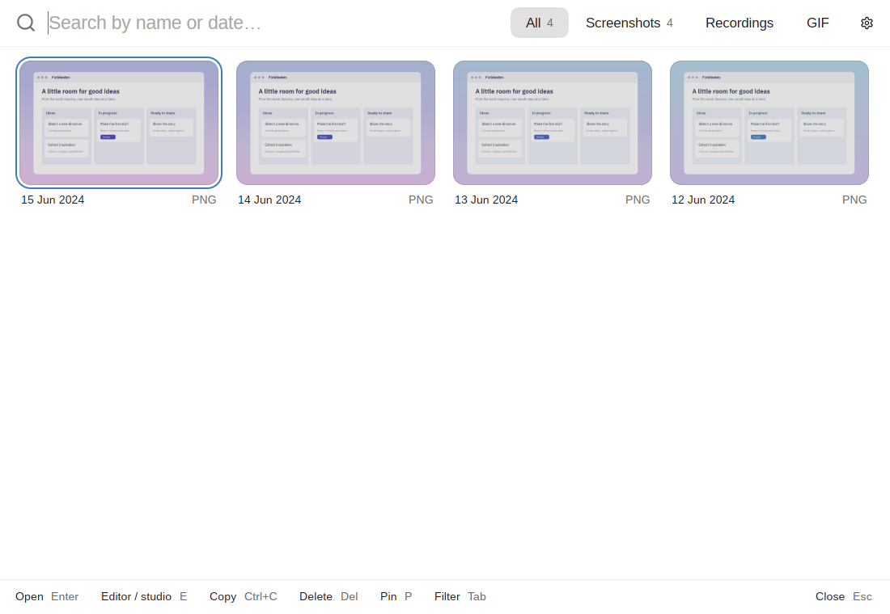

# History

Every screenshot, recording and GIF in your screenshots and recordings folders, newest first, as a grid of thumbnails. Find one by typing, then open, copy, pin or delete it, or drag it out into a chat.



## How to open

- **The hotkey.** On macOS and Windows the default is Ctrl+Shift+4; on Linux kadr starts from your Hyprland bindings. Set it in Settings → Shortcuts → History.
- **The command** `kadr history`.

## Finding a capture

Typing is the main way through the history: just start typing, there's no field to click. The search matches the file's name and its date as the tiles show it, such as "today", "yesterday" or "12 Oct". Backspace takes a letter back; Esc clears the search.

Under each thumbnail are its day and time (a capture from an earlier year shows the year instead) and its kind: PNG, MP4 or GIF. A recording shows its length on the thumbnail.

The filters at the top show one kind at a time, with how many there are: All, Screenshots, Recordings and GIF. Tab steps through them. In a narrow window they fold into a dropdown.

The history shows the 300 newest captures. With nothing found it says "Nothing found"; with nothing captured yet, "Nothing captured yet".

## Selecting

The current tile has an accent ring round it. Move it with the arrow keys, or click a tile.

- Ctrl+click adds a tile to the selection, or takes it out (Cmd+click on macOS).
- Shift+click selects every tile from the current one to the one clicked.
- Ctrl+A selects every tile shown.

With several selected, the bottom bar says how many, and Copy, Delete and Pin work on all of them. Esc lets go of the selection.

## Actions

- **Open** (Enter, or a double-click): a screenshot opens in the [Editor](editor.md), a recording in the [Studio](studio.md), a GIF in your system's viewer.
- **Editor / studio** (E): the same, for a screenshot or a recording.
- **Copy** (Ctrl+C): one screenshot goes on the clipboard as a picture; a recording, a GIF or several captures go as files. The window closes.
- **Pin** (P): pins the selected screenshots on top of every window (see [Capture](capture.md)).
- **Delete** (Del): moves the selected captures to the trash.

Hover over a tile for the same as buttons: Copy and Edit (Studio for a recording) in the middle, Show in folder at the top right, Delete at the bottom right and, for a screenshot, Pin on top at the bottom left.

Drag a tile into a chat, a browser or a file manager to drop the file there.

The gear at the top right opens [Settings](settings.md). The bottom bar lists the keys, and drops the less used ones in a narrow window.

## Keys

Ctrl is Cmd on macOS.

| Keys | Does |
|---|---|
| Typing | Search |
| Backspace | Erase a letter of the search |
| Arrows | Move between tiles |
| Enter | Open |
| E | Open in the editor or the studio (when not searching) |
| P | Pin the selected screenshots (when not searching) |
| Ctrl+C | Copy and close |
| Del | Delete to the trash |
| Tab | Next filter |
| Ctrl+A | Select every tile shown |
| Ctrl+click | Add a tile to the selection, or take it out |
| Shift+click | Select a range |
| Esc | Clear the search, then the selection, then close |

## Settings

| Setting | Key | Does |
|---|---|---|
| Screenshots → Screenshots folder | `screenshot_dir` | One of the two folders the history shows |
| Recording → Recordings folder | `video_dir` | The other one |
| Storage → Delete old captures | `cleanup_days` | Never, or after 7, 30 or 90 days: for good, once a day, only kadr's files |

Storage → Clear now deletes what's older than the chosen period at once.

## Commands

```
kadr history                                   history of screenshots and recordings
```
