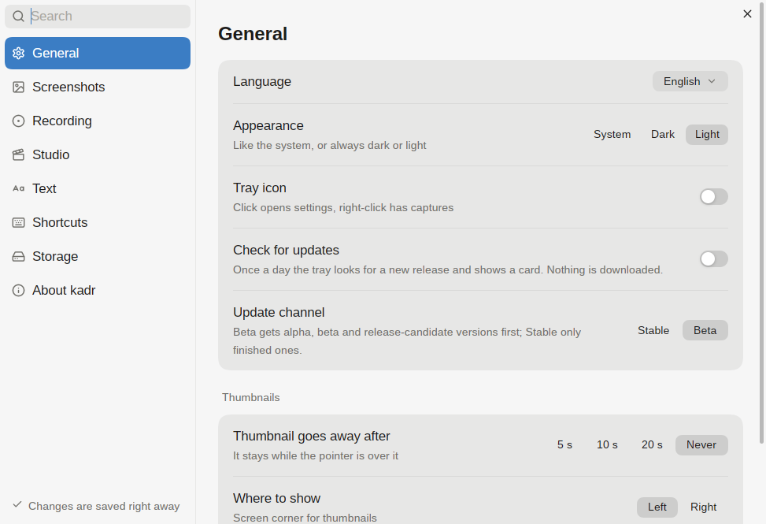

# Settings

Settings controls capture behaviour, shortcuts, the editor and studio defaults, and storage. Changes are saved right away. Search looks across sections, so you do not need to remember which section holds a row.



## How to open

Run `kadr settings`, click the tray icon, or press the assigned settings hotkey. Its default on macOS and Windows is Ctrl+Shift+5; Linux starts with your Hyprland bindings.

For window shortcuts in this manual, Ctrl means Cmd on macOS. The global defaults below use Ctrl on both macOS and Windows.

## Sections

Type to search by a row or section name. Choose a section in the sidebar to clear the search. **Thumbnails** is a group inside **General**, and **Editor** is a row inside **Screenshots**, not a separate sidebar section.

| Section or group | Rows and what they change |
|---|---|
| General | **Language**, **Appearance**, **Tray icon**, **Check for updates**, **Update channel**: interface language, system/dark/light appearance, the tray and release checks. |
| General → Thumbnails | **Thumbnail goes away after**, **Where to show**, **Thumbnails at once**: 5, 10, 20 seconds or Never; Left or Right; 2, 4 or 6 cards. A hovered card stays. |
| Screenshots → After a screenshot | **Show the thumbnail**, **Copy to the clipboard**, **Save to the folder**, **Open the editor**, **Pin on top**: independent actions after capture. |
| Screenshots → Files | **Screenshots folder**, **File name**, **Window shadow**, **Window background**, **Screenshot size**, **Pointer in screenshots**, **Self-timer**: destination and naming, window look, 1× or Screen pixels, pointer and 3/5/10-second countdown. |
| Screenshots → Editor | **Editor**: Window or Over everything. This choice is Linux-only; other systems use a window. |
| Recording → After a recording | **Show the thumbnail**, **Copy to the clipboard**, **Save to the folder**, **Open the studio**. Copy puts the file on the clipboard. Studio mode recordings open in the studio anyway. |
| Recording → Video | **Recordings folder**, **File name**, **Frame rate**, **Quality**, **Frame around the area**. Source follows the screen's rate; the other choices are 30, 60 and 120 fps. The frame is not recorded. |
| Studio | **Default zoom**, **Default background**, **Default padding**: zooms placed on clicks and the backdrop around a video. |
| Text | **Recognition languages** lists the installed languages; **Russian** offers the language-data download when needed. |
| Shortcuts | An action per row, with its assigned shortcuts and **Add shortcut**. See below. |
| Storage | **Used**, **Delete old captures**, **Clear now**: space used and old-file cleanup. See below. |
| About kadr | The kadr row shows the version and **Check now** for updates; **Interface**, **Source code**, **Settings file** give app information and access to the configuration. |

**File name** is shared by screenshots and recordings. Its template accepts `{date}`, `{time}`, `{type}` and `{n}`. **Window background** uses a look saved in the [editor](editor.md). Release channels and updating are explained in [Install](install.md).

## Shortcuts

In **Shortcuts**, click **Add shortcut** (+) beside an action, then press the combination. Esc cancels. Click an existing shortcut to remove it. Assigning a combination already used by another action moves it to the new action.

The rows are **All modes on one bar**, **Screenshot an area**, **Screenshot the previous area**, **Screenshot a window or area**, **Screenshot the screen**, **Scrolling screenshot**, **Record the screen**, **Record the previous area**, **Recognize text**, **History** and **Settings**.

The global defaults on macOS and Windows are:

| Keys | Does |
|---|---|
| Ctrl+Shift+1 | Screenshot of an area |
| Ctrl+Shift+2 | Recording |
| Ctrl+Shift+3 | Recognize text |
| Ctrl+Shift+4 | History |
| Ctrl+Shift+5 | Settings |
| Ctrl+Shift+6 | Scrolling screenshot |

On Linux, kadr starts with the existing Hyprland bindings. The installed `data/hypr/kadr.lua` hook loads the bindings saved from this window; see [Install](install.md). On macOS and Windows the tray holds the global shortcuts, so it must be running.

## Storage

**Used** shows space and file counts for **Screenshots**, **Recordings** and **Studio cache**. **Delete old captures** offers Never, 7, 30 or 90 days. Automatic cleanup runs at most once a day when enabled and permanently deletes kadr's old captures, not other files in those folders.

Choose a period first, then use **Clear now → Clear** to apply it immediately. The result reports the freed space and number of files. The file setting is `cleanup_days`; `0` disables automatic deletion. Cleanup also prunes editing data whose source capture is gone.

## Settings file

Settings live in `settings.toml`, under `~/.config/kadr` on Linux. Open **Settings → About kadr → Settings file → Edit** to edit it in the system's editor. **Show in folder** opens its folder.

Edits by hand are picked up the next time kadr needs the setting. The settings window keeps comments and ordering and changes only the values you change there. A missing setting keeps its default; an unreadable value is ignored. If the TOML file is broken, kadr uses defaults, reports where the error is in the settings window and leaves the file alone. Window changes are not saved until it is fixed. An old `settings.json` is migrated automatically and renamed to `settings.json.old`.

The groups below follow the order in the file. Some settings are available only in the file, not as rows in the window.

| Key | Comment |
|---|---|
| `version` | The file's format. |

### General

| Key | Comment |
|---|---|
| `language` | `"en"` or `"ru"`. |
| `theme` | `"system"`, `"dark"` or `"light"`. |
| `tray` | The tray icon. |
| `keep_warm` | Keep the area picker running so it shows at once (uses some memory). |
| `check_updates` | Look for new releases. |
| `update_channel` | `"stable"` or `"beta"`; left out, the channel of this build. |

### Captures

| Key | Comment |
|---|---|
| `screenshot_dir` | Where screenshots go; left out, the system's pictures folder. |
| `video_dir` | Where recordings go; left out, the system's videos folder. |
| `name_template` | New files' names: `{type}`, `{date}`, `{time}` and `{n}` are filled in. |
| `card_seconds` | How long the card after a capture stays, in seconds; `0` keeps it. |
| `card_side` | Where the cards show: `"left"` or `"right"`. |
| `max_cards` | How many cards show at once. |
| `cleanup_days` | Delete captures older than this many days; `0` keeps them. |

### Screenshots

| Key | Comment |
|---|---|
| `logical_size` | Save at 1x: a pixel of the picture is a pixel of the design. |
| `shot_cursor` | Put the pointer in screenshots. |
| `window_shadow` | Window shots keep the window's shadow, on a transparent background. |
| `window_backdrop` | A look saved in the editor, by name, for window shots to go on. |
| `timer_seconds` | The self-timer: 3, 5 or 10 seconds. |
| `editor_window` | The editor opens as an ordinary window; `false` puts it over everything (Linux). |

### Recording

| Key | Comment |
|---|---|
| `fps` | Frames a second; `0` is the screen's own rate. |
| `quality` | `"medium"`, `"high"`, `"very_high"` or `"ultra"`. |
| `region_frame` | Outline the recorded area (the outline isn't recorded). |

### Studio

| Key | Comment |
|---|---|
| `studio_zoom` | The zoom placed on clicks, 1 to 4. |
| `studio_backdrop` | The background, by its place in the studio's list (from 0). |
| `studio_padding` | How much background shows around: 0 (none) to 3. |

### Editor

| Key | Comment |
|---|---|
| `saved_colors` | Colours kept in the colour menu, as `"#rrggbb"`. |
| `recent_colors` | Colours used lately, newest first; kadr keeps this list. |

### After a screenshot

The `after_shot` table has five independent switches:

| Key | Comment |
|---|---|
| `card` | The card in the screen's corner. |
| `copy` | Copy it to the clipboard. |
| `save` | Keep the file (off: only a temporary one). |
| `edit` | Open it in the editor. |
| `pin` | Pin a screenshot above every window. |

### After a recording

The `after_video` table has the same five switches. `pin` is for screenshots, not recordings; it has no recording row in the window.

| Key | Comment |
|---|---|
| `card` | The card in the screen's corner. |
| `copy` | Copy it to the clipboard. |
| `save` | Keep the file (off: only a temporary one). |
| `edit` | Open it in the studio. |
| `pin` | Pin a screenshot above every window; does not apply to recordings. |

## Keys

Outside shortcut recording or file-name editing:

| Keys | Does |
|---|---|
| Typing | Search across all sections |
| Backspace | Remove the last search character |
| Tab or Down | Next section |
| Up | Previous section |
| Esc | Clear the search; with no search, close the window |
| Esc while recording a shortcut | Cancel without assigning it |
| Enter, Tab or Esc while editing File name | Finish editing the name template |

## Commands

```text
  kadr settings                                  settings
```
